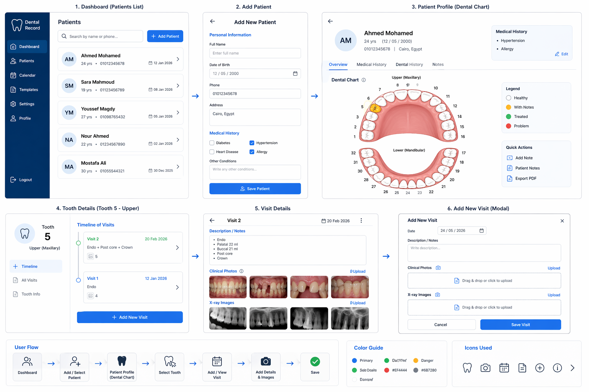
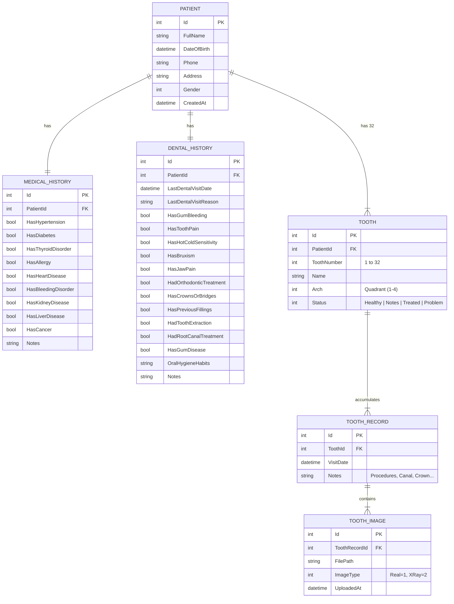

<div align="center">

# Dentra System (DPRS)

### Advanced Dental Patient Record System & Clinical Odontogram

[](https://dotnet.microsoft.com/)
[](https://learn.microsoft.com/en-us/dotnet/csharp/)
[](https://learn.microsoft.com/en-us/dotnet/desktop/wpf/)
[](https://learn.microsoft.com/en-us/ef/core/)
[](https://www.microsoft.com/sql-server)
[](https://blog.cleancoder.com/uncle-bob/2012/08/13/the-clean-architecture.html)
[](LICENSE)

<br/>

<p align="center">
  
</p>

<p align="center">
  <strong>An enterprise-grade, desktop-based Dental Electronic Health Record (EHR) system designed for dental clinicians, interns, and academic dental hospitals.</strong>
  <br />
  Featuring an interactive 32-tooth odontogram, multi-visit clinical tracking, medical & dental anamnesis risk evaluation, and multimodal diagnostic image archiving.
</p>

<p align="center">
  <a href="#-key-features">Key Features</a> •
  <a href="#-architecture--system-design">Architecture</a> •
  <a href="#-database-design--erd">Database Design</a> •
  <a href="#-tech-stack">Tech Stack</a> •
  <a href="#-getting-started">Getting Started</a> •
  <a href="#-project-structure">Project Structure</a> •
  <a href="#-author">Author</a>
</p>

---

</div>

## 📌 Executive Summary

**Dentra System (Dental Patient Record System - DPRS)** was engineered to solve the operational hurdles faced by modern dental clinics, interns, and academic dental hospitals. Traditional paper charts and legacy software are error-prone, lack structured radiological archiving, and fail to provide longitudinal visibility into individual tooth treatments.

Dentra delivers a **Clean Architecture .NET 10 solution** pairing a high-performance **WPF desktop interface** with a robust **Entity Framework Core 10** and **Microsoft SQL Server** data layer. It provides instant access to patient medical histories, clinical risk flags, interactive 4-quadrant dental mapping, and chronological visit timelines with high-resolution clinical photography and X-ray viewing.

---

## ✨ Key Features

### 🦷 Interactive Visual Dental Odontogram (FDI 32-Tooth Chart)
- **Anatomical Quadrants**: Divided into 4 standardized quadrants: Upper Right (1–8), Upper Left (9–16), Lower Left (17–24), and Lower Right (25–32).
- **Dynamic Color-Coded Status**: Teeth update in real-time based on diagnostic condition:
  - 🟢 **Healthy** (`#10B981`): Intact, sound dentition.
  - 🟡 **With Notes** (`#F59E0B`): Monitored surfaces, incipient lesions, or observation notes.
  - 🔵 **Treated** (`#3B82F6`): Completed restorations, crowns, endodontics, or prosthetics.
  - 🔴 **Problem** (`#EF4444`): Active pathology, acute pulpitis, deep caries, or fracture requiring intervention.
- **Direct Modal Exploration**: Clicking any tooth launches its dedicated history and treatment console.

### 👤 Comprehensive Patient Profiling & Anamnesis Risk Matrix
- **Automatic Age Computation**: Real-time age derivation from Date of Birth.
- **Systemic Medical History Screening (9 Critical Risk Flags)**:
  - Hypertension, Diabetes, Thyroid Disorders, Allergies, Heart Disease, Coagulopathies / Bleeding Disorders, Kidney Disease, Liver Disease, and Oncological History.
- **Detailed Dental History & Risk Evaluation (11 Clinical Indicators)**:
  - Gum bleeding, spontaneous pain, thermal sensitivity, bruxism (clenching/grinding), TMJ/jaw pain, past orthodontic therapy, crowns/bridges, existing fillings, extractions, previous endodontic treatments, and periodontal disease history.
  - Dedicated freeform clinical notes and oral hygiene habit tracking.

### 📅 Longitudinal Multi-Visit Clinical Tracking
- **Per-Tooth Chronological Timeline**: Every tooth maintains an independent treatment history across multiple dates.
- **Comprehensive Encounter Details**: Document visit date, operative procedures (endodontics, canal length, post & core, composite restorations), and clinical observations.
- **Dynamic Status Progression**: Updating a tooth's status on a new visit updates the primary odontogram across the patient's record.

### 🖼️ Diagnostic Imaging Suite & Lightbox Viewer
- **Bimodal Classification**: Segregates assets into **Intraoral Clinical Photos** vs. **Radiological X-Rays** (periapical, bitewing, panoramic).
- **Automated Physical Storage**: Structured file-system hierarchy partitioned dynamically by patient and tooth ID (`Images/Patient_{Id}/Tooth_{Id}/{guid}.jpg`).
- **Integrated Lightbox Viewer**: Full-screen modal with image enlargement, next/previous navigation, and high-fidelity rendering for fine-detail diagnostic review.

### 📊 Modern Ergonomic Dashboard & Patient Registry
- **Instant Search & Filter**: Real-time debounce search by patient name or phone number.
- **Overview Metrics**: Active patient counts and recent consultation feeds.
- **Modern WPF Styling**: Polished dark navy sidebar (`#063B75`), clean slate work surfaces (`#F8FAFC`), and custom-styled control templates.

---

## 🏗️ Architecture & System Design

The system strictly adheres to **Clean Architecture** (Separation of Concerns / N-Tier Architecture) and **Domain-Driven Design (DDD)** principles, guaranteeing high testability, maintainability, and scalability.

```
                  ┌────────────────────────────────────────┐
                  │               Dental.UI                │
                  │   (WPF Desktop Presentation Layer)     │
                  │   Views • Controls • DI Composition   │
                  └───────────────────┬────────────────────┘
                                      │
                                      ▼
                  ┌────────────────────────────────────────┐
                  │           Dental.Application           │
                  │        (Business & Use Cases)          │
                  │  PatientService • ToothRecordService   │
                  └─────────┬────────────────────┬─────────┘
                            │                    │
                            ▼                    ▼
     ┌─────────────────────────────┐      ┌─────────────────────────────┐
     │         Dental.Core         │      │    Dental.Infrastructure    │
     │    (Domain Entities &       │◄─────┤ (EF Core 10 • DbContext     │
     │       Enums / Contracts)    │      │  SQL Server • Migrations)   │
     └─────────────────────────────┘      └─────────────────────────────┘
```

### Architectural Layer Responsibilities

| Layer | Project | Role & Responsibilities |
| :--- | :--- | :--- |
| **Presentation** | `Dental.UI` | Modern WPF desktop UI, XAML resource dictionaries, window lifecycle management, UI commands, data binding, and application bootstrapping (`Microsoft.Extensions.DependencyInjection`). |
| **Application** | `Dental.Application` | Orchestrates business workflows, transaction boundaries, image saving strategies, note aggregation, and default 32-tooth odontogram generation. |
| **Core Domain** | `Dental.Core` | Pure domain models (`Patient`, `Tooth`, `ToothRecord`, `ToothImage`, `MedicalHistory`, `DentalHistory`), value enums, and domain logic with **zero external dependencies**. |
| **Infrastructure** | `Dental.Infrastructure` | Data access layer leveraging **Entity Framework Core 10**, Code-First schema migrations, `AppDbContext`, and SQL Server relational mappings. |

---

## 🗄️ Database Design & ERD

The relational schema is configured with Fluent API in `AppDbContext` to enforce referential integrity and optimized cascading relationships:



---

## 🛠️ Tech Stack

| Domain | Technology / Library | Purpose |
| :--- | :--- | :--- |
| **Platform** | [.NET 10.0](https://dotnet.microsoft.com/) (`net10.0-windows`) | High-performance managed runtime |
| **Language** | [C# 13.0](https://learn.microsoft.com/en-us/dotnet/csharp/) | Modern object-oriented programming with nullable reference types |
| **UI Framework** | [Windows Presentation Foundation (WPF)](https://learn.microsoft.com/en-us/dotnet/desktop/wpf/) | Desktop graphics, XAML vector rendering, and hardware-accelerated layouts |
| **ORM** | [Entity Framework Core 10.0.7](https://learn.microsoft.com/en-us/ef/core/) | Object-Relational Mapping with Code-First Migrations |
| **Database Engine** | [Microsoft SQL Server](https://www.microsoft.com/sql-server) | Enterprise relational database |
| **Dependency Injection** | [Microsoft.Extensions.DependencyInjection](https://www.nuget.org/packages/Microsoft.Extensions.DependencyInjection/) | Inversion of Control container for application services |
| **Configuration** | [System.Configuration.ConfigurationManager](https://www.nuget.org/packages/System.Configuration.ConfigurationManager/) | Externalized connection string configuration (`App.config`) |

---

## 🚀 Getting Started

### Prerequisites
- Windows 10 (Build 19041+) or Windows 11 (x64)
- [.NET 10.0 SDK](https://dotnet.microsoft.com/download/dotnet/10.0) or later
- [Microsoft SQL Server](https://www.microsoft.com/en-us/sql-server/sql-server-downloads) (Express, Developer, or LocalDB)
- [Visual Studio 2022 (v17.10+)](https://visualstudio.microsoft.com/) or [JetBrains Rider](https://www.jetbrains.com/rider/) with desktop .NET workload

---

### Step 1: Clone the Repository
```bash
git clone https://github.com/Abd-Alrahman-Saed/Dentra-System.git
cd Dentra-System
```

---

### Step 2: Configure Database Connection
Open `Dental.UI/App.config` and verify or adapt your SQL Server connection string:
```xml
<connectionStrings>
    <add name="DefaultConnection"
         connectionString="Server=.\SQLEXPRESS;Database=DentalPatientRecordDb;Trusted_Connection=True;TrustServerCertificate=True;"
         providerName="System.Data.SqlClient" />
</connectionStrings>
```
> [!TIP]
> If using SQL Server LocalDB, set the connection string to:
> `Server=(localdb)\mssqllocaldb;Database=DentalPatientRecordDb;Trusted_Connection=True;`

---

### Step 3: Apply Database Migrations
Run the following command from the root directory to automatically create the database and apply all EF Core migrations:

```powershell
dotnet ef database update --project Dental.Infrastructure --startup-project Dental.UI
```

---

### Step 4: Build & Run
You can launch the solution directly from the CLI:
```powershell
dotnet run --project Dental.UI
```
Or open `Dentra.sln` / `Dentra.slnx` in Visual Studio and press <kbd>F5</kbd>.

---

### 📦 Building a Standalone Executable (Distribution)
To generate a self-contained, single-folder release package for client PCs without requiring .NET SDK to be installed:
```powershell
dotnet publish Dental.UI/Dental.UI.csproj -c Release -r win-x64 --self-contained true -p:PublishSingleFile=false -o ./publish
```

---

## 📂 Project Structure

```
Dentra-System/
├── Dental.Core/                         # [Domain Layer]
│   ├── Entities/                        # Domain models
│   │   ├── Patient.cs                   # Patient core entity
│   │   ├── Tooth.cs                     # Anatomical tooth model (1..32)
│   │   ├── ToothRecord.cs               # Encounter & visit history
│   │   ├── ToothImage.cs                # Diagnostic image reference
│   │   ├── MedicalHistory.cs            # Systemic medical anamnesis
│   │   └── DentalHistory.cs             # Oral dental anamnesis
│   └── Enums/
│       └── Enums.cs                     # Gender, ToothStatus, ImageType, ToothArch
│
├── Dental.Application/                  # [Application Layer]
│   └── Services/                        # Business logic services
│       ├── PatientService.cs            # Patient CRUD & odontogram bootstrap
│       ├── ToothService.cs              # Tooth queries & detail loading
│       └── ToothRecordService.cs        # Visit management & dynamic image persistence
│
├── Dental.Infrastructure/               # [Infrastructure Layer]
│   ├── Data/
│   │   ├── AppDbContext.cs              # EF Core database context & mappings
│   │   └── AppDbContextFactory.cs       # Design-time factory for migrations
│   └── Migrations/                      # Code-First database migration snapshots
│
├── Dental.UI/                           # [Presentation Layer]
│   ├── Views/                           # WPF Windows & Dialogs
│   │   ├── DashboardWindow.xaml         # Main clinical dashboard
│   │   ├── AddPatientWindow.xaml        # Patient intake form
│   │   ├── PatientProfileWindow.xaml    # Profile & 32-tooth odontogram view
│   │   ├── ToothDetailsWindow.xaml      # Tooth clinical visit timeline
│   │   ├── AddNewVisitWindow.xaml       # Visit & diagnostic upload modal
│   │   ├── VisitDetailsWindow.xaml      # Detailed visit & procedure viewer
│   │   ├── ImageViewerWindow.xaml       # Lightbox image zoom modal
│   │   └── AddNoteWindow.xaml           # Quick note entry modal
│   ├── App.config                       # Application & database configurations
│   ├── App.xaml / App.xaml.cs           # Dependency injection container & startup
│   └── AssemblyInfo.cs
│
├── Documentations/                      # Specifications & System Diagrams
│   ├── banner.png                       # UI hero banner
│   ├── architecture-erd.png             # Relational ERD diagram
│   ├── odontogram-concept.png           # Odontogram clinical chart
│   └── User Requirements Document Dental Patient Record System.pdf
│
├── Images/                              # Sample clinical & X-ray asset storage
├── Dentra.sln                           # Solution file (Visual Studio 2022)
├── Dentra.slnx                          # Modern XML solution file (.NET 10)
├── .gitignore                           # Production .NET gitignore
├── .gitattributes                       # Line ending & git attribute rules
├── LICENSE                              # MIT License
└── README.md                            # Comprehensive documentation
```

---

## 💡 Engineering Highlights (For Technical Reviewers)

- **Clean Architecture & Separation of Concerns**: Core domain entities have zero external dependencies, making domain logic immune to framework or database shifts.
- **Dependency Injection**: Services and DbContexts are managed cleanly through `Microsoft.Extensions.DependencyInjection`, registered in `App.xaml.cs` and injected into UI controllers.
- **Relational Integrity & EF Core 10**: Fully typed Fluent API configurations, cascading deletes where appropriate, and design-time factories (`AppDbContextFactory`) supporting seamless CI/CD migration execution.
- **Dynamic File System Management**: Image uploads dynamically resolve paths using hierarchical directory creation (`Patient_{id}/Tooth_{id}/`), preventing directory collisions and supporting custom environment path overrides (`DENTRA_IMAGES_PATH`).
- **Asynchronous I/O**: All database transactions and file handling utilize modern C# `async`/`await` patterns (`ToListAsync`, `FirstOrDefaultAsync`, `SaveChangesAsync`) to maintain a fluid 60 FPS WPF UI thread.

---

## 📄 License

This project is licensed under the **MIT License** - see the [LICENSE](LICENSE) file for details.

---

## 👨‍💻 Author

<div align="center">

**Abd Alrahman Saed**  
*Software Engineer | .NET & Desktop Architecture*

[](https://github.com/Abd-Alrahman-Saed)
[](https://www.linkedin.com/in/abdalrahman-saed)

*Engineered with passion for clean software design and healthcare innovation.*

</div>
